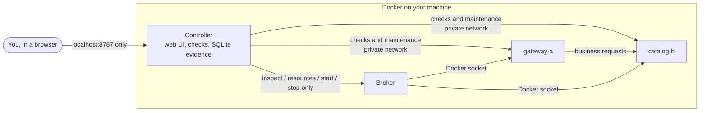

# AegisRack

A hands-on lab for practising Linux service troubleshooting. Two small web services run in Docker containers. The lab breaks one of them on purpose (stops it, starves it of CPU, fills its disk or drifts its configuration), and you investigate with real checks, choose a fix, and watch the lab verify whether the service actually came back.

> **Two ways to look at it**
> - **[Browser simulator](https://choochootrain23.github.io/aegis-fault-lab/)**: a quick look in any browser. Nothing is installed and **nothing in it is real**: services and measurements are generated in your tab.
> - **[Full lab](#run-the-full-lab-locally)**: the real thing on your own machine, with real containers, real failures and measured evidence. About 10 minutes to set up.

**Status:** a working milestone. Four fault types are implemented on either service and validated end to end on real Docker. A network-delay scenario and an AI assistant are planned; see [limitations and next steps](#limitations-and-next-steps).

## Contents

1. [Try it in your browser](#try-it-in-your-browser)
2. [Run the full lab locally](#run-the-full-lab-locally)
3. [Your first investigation](#your-first-investigation)
4. [The four faults](#the-four-faults)
5. [Stop, restart and uninstall](#stop-restart-and-uninstall)
6. [Troubleshooting](#troubleshooting)
7. [How it works](#how-it-works)
8. [Development and validation](#development-and-validation)
9. [Limitations and next steps](#limitations-and-next-steps)

## Try it in your browser

**[Open the browser simulator →](https://choochootrain23.github.io/aegis-fault-lab/)**

The simulator runs the same web UI against a JavaScript copy of the controller's rules, so you can try the workflow without installing anything. It is clearly marked **SIMULATION**: no containers run, every number is generated in your tab, and its state resets when you reload.

Try this: start a practice investigation on the shared catalogue, compare the gateway's liveness and business checks, inspect the catalogue's container state, try starting the *wrong* node first, then start the right one and watch the three verification cycles.

## Run the full lab locally

### 1. What you need

| | Requirement |
| --- | --- |
| Operating system | **Linux** (tested on Ubuntu). **Windows**: use WSL2 with Ubuntu and run every command inside the Ubuntu terminal. macOS is untested. |
| Docker | Docker Engine with the Compose v2 plugin (`docker compose version` should print a version) |
| Python | Python 3.10 or newer, for the small setup scripts (standard library only) |
| Resources | About 2 GiB free memory and 10 GiB free disk |
| Tools | `git` |

On Ubuntu, install Docker by following [Docker's official guide](https://docs.docker.com/engine/install/ubuntu/). Your user needs permission to run `docker` without `sudo`: Docker's [post-installation step](https://docs.docker.com/engine/install/linux-postinstall/) adds you to the `docker` group (log out and back in afterwards). Note that `docker` group membership is equivalent to administrator access on that machine.

Check Docker works before continuing:

```bash
docker run --rm hello-world
```

### 2. Download and check

```bash
git clone https://github.com/choochootrain23/aegis-fault-lab.git
cd aegis-fault-lab
python3 scripts/preflight.py
```

`preflight.py` only reads: it checks free memory and disk, and that Docker supports the resource limits the lab relies on. It should end with `Preflight passed`.

### 3. Create the local secrets

```bash
python3 scripts/init_env.py
```

This writes two random credentials to `.env` (readable only by you): one for the broker and one for the services' maintenance endpoints. It never changes existing values, and `.env` is excluded from git.

**Upgrading an existing install?** Run `python3 scripts/init_env.py` again (it only adds missing credentials), then `docker compose up -d --build`.

### 4. Build and start

```bash
docker compose build
docker compose up -d
docker compose ps
```

The first build downloads a Python base image and takes a few minutes. `docker compose ps` should list four running containers: `controller`, `broker`, `gateway-a` and `catalog-b`.

### 5. Open the lab

Open **http://localhost:8787** in a browser on the same machine.

**Lab inside a VM or on another machine?** Forward the port over SSH from the computer you browse on: `ssh -L 8787:localhost:8787 you@lab-machine`, then open http://localhost:8787 there. In VS Code Remote-SSH, the **Ports** panel can forward 8787 for you. Use `localhost`, not the machine's IP address: the lab deliberately rejects other addresses.

The page shows **Collecting a healthy baseline** with a 0/5 meter. After about ten seconds both nodes turn **healthy** and **Start investigation** turns green.

## Your first investigation

New here? Press the yellow **TOUR** button in the top bar for a 60-second guided look at each part of the page; you can retake it any time. The **Suggested next** card always shows a sensible next step, but you can explore in any order.

1. Leave **Mode** on **Practice · known fault**, **Fault** on **Stopped service** and **Target** on **Catalogue (shared)**, then press **Start investigation**. The lab really stops the `catalog-b` container.
2. Within about six seconds the live map changes: `gateway-a` turns **degraded** (alive, but its requests fail) and `catalog-b` turns **unavailable**.
3. Click a node and run its checks: **Process liveness**, **Business request**, **Container state**, **Resource use**, **Disk usage**, **Running config**, **Request trace** and **Service logs**. Each result is stored in the **Evidence notebook**; open a record to see the raw measurement.
4. Stuck? **A little direction?** offers an evidence explanation, a hint or one suggested action. Help is optional and recorded.
5. Select a node and choose a recovery action: **Start service**, **Stop runaway job**, **Clear temp files** or **Restore config**. Trying the wrong one is allowed; it reports that nothing changed and is recorded. An accepted action is not proof: the lab needs **three healthy, fast cycles in a row** before it shows **Recovery verified**.
6. Optionally write your diagnosis, ticking the evidence that supports it, then press **End & reset** to restore both services. The **Incident report** shows how long detection, checks and recovery took, and **Replay** animates every request over time. Past investigations, each with its own replay, stay in **Investigation history**.

**Keyboard shortcuts:** **G** and **C** select a node, **1**–**8** run its checks, **E** explains the evidence, **P** pauses the notebook and **?** lists them all. Nothing that changes the services has a shortcut.

## The four faults

Each fault can target either service. A fault on the shared catalogue spreads to the gateway; a fault on the gateway stays local.

| Fault | What you see | Evidence that gives it away | Fix |
| --- | --- | --- | --- |
| **Stopped service** | The service's own checks fail; on the catalogue, the gateway stays live but its requests fail | **Container state** reads stopped | **Start service** |
| **CPU starvation** | Everything still answers, just slowly (above 300 ms) | **Resource use** shows CPU at the container's limit with throttling; logs record a job starting | **Stop runaway job** |
| **Disk full** | The process stays live, but requests fail with HTTP 507 | **Disk usage** shows `/tmp` full, with one large filler file | **Clear temp files** |
| **Config drift** | Liveness, CPU and disk look normal, yet requests fail; on the gateway it looks exactly like a stopped catalogue | **Running config** shows a setting that differs from what was deployed; **Request trace** shows which step fails | **Restore config** |

**Request trace** times each step of one request (the upstream call, the receipt write, and time spent outside the handler) as a waterfall, so you can see where a request is slow or where it breaks.

**Challenge · hidden fault** picks a random fault and service and hides both until you reveal them or end the attempt. The 15-minute timer can be extended; if it runs out and you don't respond within 60 seconds, the lab resets itself, even with the browser closed.

## Stop, restart and uninstall

```bash
docker compose stop        # pause everything; investigation history is kept
docker compose up -d       # start again later
docker compose down        # remove the containers; history is still kept in a Docker volume
docker compose down -v     # remove containers AND all investigation history
```

Only this project's containers, networks and volume are touched; nothing else on your machine is cleaned up.

If the web page stops responding mid-investigation, bring the services back with:

```bash
docker compose start catalog-b gateway-a
docker compose up -d controller broker
```

Then reopen the page and press **End & reset** so the lab re-verifies a healthy baseline.

## Troubleshooting

| Symptom | What to do |
| --- | --- |
| `permission denied ... docker.sock` | Your user cannot use Docker yet. Follow Docker's post-installation step above, log out and in, then retry. Do not `chmod` the socket. |
| `Run scripts/init_env.py first` | Step 3 was skipped, or an older `.env` lacks a newer credential. Run `python3 scripts/init_env.py`, then `docker compose up -d`. |
| `port is already allocated` on 8787 | Something else uses port 8787. Stop it, then `docker compose up -d` again. |
| Page says **Untrusted host** | Browse to `http://localhost:8787` (or forward the port as in step 5) rather than an IP address. |
| Nodes stay **Unknown** | Run `docker compose ps`; all four containers should be running. `docker compose logs controller` shows errors. |
| Preflight reports low memory | Close other programs and retry. The lab needs about 2 GiB free to run with its resource limits. |

## How it works



- **gateway-a** and **catalog-b** are two small Python web services. The gateway depends on the catalogue, so a fault in the catalogue breaks or slows the gateway's requests even though the gateway itself is still running. Every business request also writes a small receipt to the service's 8 MiB `/tmp`, so a full disk causes real write errors.
- The **controller** serves the web page, runs health checks every two seconds, stores every observation as evidence in SQLite, and runs the investigation rules: a fault can only start from a healthy baseline, and recovery only counts after three healthy cycles in a row.
- The **broker** is the only part that can touch Docker. It accepts just four fixed operations on these two containers (inspect, read resource use, start, stop) and checks their identity and security settings first. The web page never gets Docker access.
- The CPU, disk and configuration faults are injected and cleared through small maintenance endpoints inside each service, protected by a separate token. Filling refuses to run unless `/tmp` really is a small bounded tmpfs, and never writes more than 16 MiB.
- The service containers run read-only, as a non-root user, with no Linux capabilities, capped memory and CPU, and no ports open to your network. The UI listens on `localhost` only.

**Evidence and storage.** Detailed records are kept for 24 hours, and evidence for an active investigation is protected. Ended summaries and their actions remain for 30 days. Exports put cited observations first, plus recent detail within 8 MiB, and report anything omitted. **Run retention cleanup** only removes records that policy allows; it never erases active work.

The timer, challenge secrecy, evidence retention and recovery rules are explained in [architecture](docs/architecture.md) and the [fault catalogue](docs/fault-catalogue.md). Challenge secrecy is a learning boundary, not an exam lock: whoever controls Docker on the machine can see which container changed.

## Development and validation

### Backend tests

```bash
python3 -m venv .venv
.venv/bin/python -m pip install -r requirements.lock
.venv/bin/python -m pytest -q
AEGIS_PROCESS_TESTS=1 .venv/bin/python -m pytest -q   # also starts two real service processes
```

Workflow tests use explicit test doubles; the shipped runtime has no fake fleet mode. The optional process test starts two temporary Python services on loopback, stops and restarts the catalogue, and checks real HTTP effects. It does **not** prove Docker or network isolation.

Without Docker, you can still run the controller to see the unavailable states (nodes stay unknown and faults are blocked):

```bash
.venv/bin/python -m uvicorn aegis.controller:app --host 127.0.0.1 --port 8787 --no-access-log
```

Run one controller per state database; a file lock rejects a second one. A restart restores recorded action results without replaying them and requires fresh verification checks.

### Validation on real Docker

With the lab running and no active investigation, the scenario matrix runs every fault on both services, then challenge rounds until every fault and target has appeared:

```bash
python3 scripts/validate_scenarios.py --run
```

Each round identifies the fault from evidence alone, checks the guidance, confirms that wrong remedies change nothing, verifies recovery and resets. Reports go to the ignored `state/validation/` folder. Related checks:

```bash
python3 scripts/validate_f1.py --run             # the original stopped-service walkthrough, three rounds
.venv/bin/python scripts/verify_runtime.py       # actual container limits and broker contract (no investigation active)
```

Each `--run` script deliberately interrupts the project's services and refuses to start while an investigation is active.

### Browser tests

These need Playwright (validated with 1.64.0) and Chromium, installed separately from the runtime dependencies:

```bash
.venv/bin/python -m pip install playwright==1.64.0
.venv/bin/python -m playwright install chromium --only-shell
```

| Command | What it covers |
| --- | --- |
| `.venv/bin/python scripts/validate_browser.py --run` | Challenge secrecy, controller restart mid-investigation, diagnosis and recovery through the UI, against the real Docker lab |
| `.venv/bin/python tests/browser_review.py` | Desktop and phone layouts, archive, citations and keyboard use, with its own controller and labelled test records (needs port 8787 free) |
| `.venv/bin/python tests/browser_workflow.py` | The active workflow against two real service processes, with accelerated timing (needs port 8787 free) |
| `.venv/bin/python tests/preview_walkthrough.py` | The browser simulator: practice, challenge, every fault, report replay, tour and live map |

`node tests/view-model.mjs` runs the pure UI-logic checks if Node.js is installed. See [validation boundaries](docs/VALIDATION.md) for what each layer does and does not establish.

### Browser simulator

The simulator is published by `.github/workflows/pages.yml` on every push to `main`. To build and view it locally:

```bash
python3 scripts/build_preview.py            # writes the ignored site/ folder
python3 -m http.server -d site 8000         # then open http://localhost:8000
```

The build copies `web/` unchanged apart from relabelling every real-measurement claim, and fails if an expected label is missing.

## Limitations and next steps

- **Scenarios:** four are implemented (stopped service, CPU starvation, disk full, config drift). Network delay and a third node are planned.
- **AI assistant:** not implemented. All guidance is deterministic, and no model requests are sent.
- **Not yet validated:** storage-pressure exhaustion, multi-hour runs, broader accessibility auditing and browsers other than Chromium. The 15-minute expiry and a controller kill during a Docker action do pass on real Docker (see [validation](docs/VALIDATION.md)).
- **Scope:** containers share a kernel, and the business data is synthetic. Nothing here claims physical hardware repair or telemetry.

More detail: [implementation checkpoint](docs/IMPLEMENTATION_STATUS.md), [vision](docs/vision.md), [architecture](docs/architecture.md) and [roadmap](docs/roadmap.md).

Fonts in `web/fonts/` (Archivo, Inter, Geist Mono, Instrument Serif) are self-hosted under the SIL Open Font License; see `web/fonts/LICENSES.txt`.
