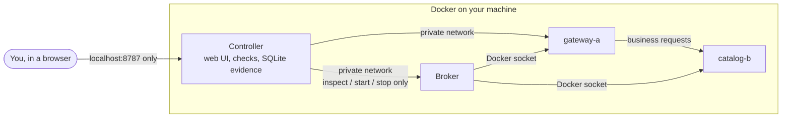

# AegisRack

A hands-on lab for practising Linux service troubleshooting. Two small web services run in Docker containers; the lab deliberately stops one of them, and you investigate with real checks, decide what to restart, and watch the lab verify whether service actually came back.

> **Two ways to look at it**
> - **[Browser simulator](https://choochootrain23.github.io/aegis-fault-lab/)**: a quick look in any browser. Nothing is installed and **nothing in it is real**: services and measurements are generated in your tab.
> - **Full lab (below)**: the real thing on your own machine, with real containers, real failures and measured evidence. About 10 minutes to set up.

**Status:** working milestone, not a finished portfolio. Three fault types (a stopped service, CPU starvation from a runaway job, and a full disk) are implemented, each on either service, and validated end to end on real Docker; a network-delay scenario and an AI assistant are planned. See [current limitations](#current-limitations-and-next-gates).

## How it works



- **gateway-a** and **catalog-b** are two small Python web services. The gateway depends on the catalogue, so a fault in the catalogue breaks or slows the gateway's requests even though the gateway itself is still running. Every business request also writes a small receipt to the service's 8 MiB `/tmp`, so a full disk causes real write errors.
- The **controller** serves the web page, runs health checks every two seconds, stores every observation as evidence in SQLite, and runs the investigation rules: a fault can only start from a healthy baseline, and recovery only counts after three healthy cycles in a row.
- The **broker** is the only part that can touch Docker. It accepts just four fixed operations on these two containers (inspect, read resource use, start, stop) and checks their identity and security settings first. The web page never gets Docker access.
- The CPU and disk faults are injected and cleared through small maintenance endpoints inside each service, protected by a separate token. Filling refuses to run unless `/tmp` really is a small bounded tmpfs, and never writes more than 16 MiB.
- The fleet containers run read-only, as a non-root user, with no Linux capabilities, capped memory/CPU and no ports open to your network. The UI listens on `localhost` only.

## Try it in your browser

**[Open the browser simulator →](https://choochootrain23.github.io/aegis-fault-lab/)**

The simulator runs the same web UI against a JavaScript copy of the controller's rules, so you can try the workflow without installing anything. It is clearly marked **SIMULATOR**: no containers run, every number is generated in your tab, and its state resets when you reload.

Try this: start a practice investigation on the shared catalogue, compare the gateway's liveness and business checks, inspect the catalogue's container state, try starting the *wrong* node first, then start the right one and watch the three verification cycles.

## Run the full lab locally

### 1. What you need

| | Requirement |
| --- | --- |
| Operating system | **Linux** (tested on Ubuntu). **Windows**: use WSL2 with Ubuntu and run every command inside the Ubuntu terminal. macOS is untested. |
| Docker | Docker Engine with the Compose v2 plugin (`docker compose version` should print a version) |
| Python | Python 3.10 or newer, for the small setup scripts (standard library only) |
| Resources | About 2 GiB free memory and 10 GiB free disk |
| Tools | `git` |

On Ubuntu, Docker can be installed by following [Docker's official guide](https://docs.docker.com/engine/install/ubuntu/). Your user needs permission to run `docker` without `sudo`: Docker's [post-installation step](https://docs.docker.com/engine/install/linux-postinstall/) adds you to the `docker` group (log out and back in afterwards). Note that `docker` group membership is equivalent to administrator access on that machine.

Check Docker works before continuing:

```bash
docker run --rm hello-world
```

### 2. Download and check

```bash
git clone https://github.com/choochootrain23/aegis-fault-lab.git
cd aegis-fault-lab
python3 scripts/preflight.py
```

`preflight.py` only reads: it checks free memory and disk and that Docker supports the resource limits the lab relies on. It should end with `Preflight passed`.

### 3. Create the local secret

```bash
python3 scripts/init_env.py
```

This writes two random credentials to `.env` (readable only by you): one for the broker and one for the services' maintenance endpoints. It never changes existing values, and `.env` is excluded from git.

**Upgrading an existing install?** Run `python3 scripts/init_env.py` again (it only adds missing credentials), then `docker compose up -d --build`.

### 4. Build and start

```bash
docker compose build
docker compose up -d
docker compose ps
```

The first build downloads a Python base image and takes a few minutes. `docker compose ps` should list four running containers: `controller`, `broker`, `gateway-a` and `catalog-b`.

### 5. Open the lab

Open **http://localhost:8787** in a browser on the same machine.

- **Lab inside a VM or on another machine?** Forward the port over SSH from the computer you browse on: `ssh -L 8787:localhost:8787 you@lab-machine`, then open http://localhost:8787 there. In VS Code Remote-SSH, the **Ports** panel can forward 8787 for you. Use `localhost`, not the machine's IP: the lab deliberately rejects other addresses.

The page shows **Collecting a healthy baseline** with a 0/5 meter. After about ten seconds both nodes turn **healthy** and **Start investigation** turns green.

## Your first investigation

The **Suggested next** card always shows a sensible next step, but you can explore in any order.

New here? Press the yellow **TOUR** button in the top bar for a 60-second guided look at each part of the page. It stays in the bar, so you can retake it any time.

1. Leave the mode on **Practice · known fault**, the fault on **Stopped service** and the target on **Shared dependency · catalogue**, then press **Start investigation**. The lab really stops the `catalog-b` container.
2. Within about six seconds the topology changes: `gateway-a` turns **degraded** (alive, but its requests fail) and `catalog-b` **unavailable**.
3. Click a node, then run checks: **Process liveness**, **Business request**, **Container state**, **Resource use**, **Disk usage** and **Service logs**. Each result is stored in the **Evidence notebook**; open a record to see the raw measurement.
4. Stuck? **A little direction?** offers an evidence explanation, a hint or one suggested action. Help is optional and recorded.
5. Select a node and choose a recovery action: **Start service**, **Stop runaway job** or **Clear temp files**. Trying the wrong one is allowed; it reports that nothing changed and is recorded. An accepted action is not proof: the lab needs **three healthy, fast cycles in a row** before it shows **Recovery verified**.
6. Optionally write your diagnosis, ticking the evidence that supports it, then press **End & reset** to restore both services. The **Incident report** shows how long detection, checks and recovery took, and **Replay** animates every request over time. Past investigations, each with its own replay, stay in **Investigation history**.

Then try the other faults. **CPU starvation** keeps the service up but slow: compare latency and **Resource use**. **Disk full** keeps it live but failing writes with HTTP 507: compare **Disk usage**. Try each on the gateway too, and notice which faults spread to the other service.

**Challenge · hidden fault** picks a random fault type and service and hides both until you reveal them or end the attempt. The 15-minute timer can be extended; if it runs out and you don't respond within 60 seconds, the lab resets itself, even with the browser closed.

## Stop, restart and uninstall

```bash
docker compose stop        # pause everything; investigation history is kept
docker compose up -d       # start again later
docker compose down        # remove the containers; history is still kept in a Docker volume
docker compose down -v     # remove containers AND all investigation history
```

Only this project's containers, networks and volume are touched; nothing else on your machine is cleaned up.

If the web page stops responding mid-investigation, bring the services back with:

```bash
docker compose start catalog-b gateway-a
docker compose up -d controller broker
```

Then reopen the page and press **End & reset** so the lab re-verifies a healthy baseline.

## Troubleshooting

| Symptom | What to do |
| --- | --- |
| `permission denied ... docker.sock` | Your user cannot use Docker yet. Follow Docker's post-installation step above, log out and in, then retry. Do not `chmod` the socket. |
| `Run scripts/init_env.py first` | Step 3 was skipped, or an older `.env` lacks the newer credential. Run `python3 scripts/init_env.py`, then `docker compose up -d`. |
| `port is already allocated` on 8787 | Something else uses port 8787. Stop it, then `docker compose up -d` again. |
| Page says **Untrusted host** | Browse to `http://localhost:8787` (or forward the port as in step 5) rather than an IP address. |
| Nodes stay **Unknown** | Run `docker compose ps`; all four containers should be running. `docker compose logs controller` shows errors. |
| Preflight reports low memory | Close other programs and retry. The lab needs about 2 GiB free to run with its resource limits. |

## More detail

The timer, challenge secrecy, evidence retention and recovery rules are explained in [architecture](docs/architecture.md) and the [fault catalogue](docs/fault-catalogue.md). Challenge secrecy is a learning boundary, not an exam lock: whoever controls Docker on the machine can see which container stopped.

## Development and validation

```bash
python3 -m venv .venv
.venv/bin/python -m pip install -r requirements.lock
.venv/bin/python -m pytest -q
AEGIS_PROCESS_TESTS=1 .venv/bin/python -m pytest -q
```

The optional process test starts two temporary project-owned Python services on loopback, stops/restarts its catalogue process, checks real HTTP effects and cleans both processes up. It does **not** prove Docker/network isolation. Workflow tests use explicit test doubles; the shipped runtime has no fake fleet mode.

You can inspect the UI's unavailable-state behaviour without Docker:

```bash
.venv/bin/python -m uvicorn aegis.controller:app --host 127.0.0.1 --port 8787 --no-access-log
```

Nodes will correctly remain unavailable/unknown and fault injection is blocked without a healthy baseline and reachable broker. This is not a substitute for a running fleet demonstration.

Run one controller worker per state database. A local file lock rejects competing controllers; it releases automatically when the owner exits. Restart restores recorded action results without replaying mutations and requires fresh verification checks. If reset was interrupted, inspect current state and explicitly retry reset.

## Docker walkthrough (once daemon access is available)

With the project running and no active investigation, the full scenario matrix runs every fault on both services, then challenge rounds until every fault and target has appeared:

```bash
python3 scripts/validate_scenarios.py --run
```

Each round identifies the fault from evidence alone, checks guidance, confirms that wrong remedies change nothing, verifies recovery and resets. The older stopped-service walkthrough is still available:

```bash
python3 scripts/validate_f1.py --run
```

This deliberately interrupts the project catalogue, captures independent evidence, tries an unhelpful gateway recovery, verifies catalogue recovery, and resets the lab, three times. It uses the controller's bounded operator API and writes a timestamped report in ignored `state/validation/`. It refuses to interrupt an existing investigation. All three rounds passed on 20 October 2026: detection took 5.59–5.67 seconds and verified recovery took 7.36–7.41 seconds on this VM.

After ending any investigation, verify the fleet's actual limits and broker inspection contract:

```bash
.venv/bin/python scripts/verify_runtime.py
```

With Playwright/Chromium installed, `python scripts/validate_browser.py --run` exercises challenge secrecy, controller restart during investigation, fresh diagnosis and browser-driven recovery/reset against the production Docker deployment. It deliberately interrupts project services and refuses an existing active investigation.

Rebuild and check the browser simulator (it is published by `.github/workflows/pages.yml` on every push to `main`):

```bash
python3 scripts/build_preview.py            # writes the ignored site/ folder
python3 -m http.server -d site 8000         # optional local look at http://localhost:8000
python tests/preview_walkthrough.py         # Chromium walkthrough; needs Playwright
```

The build copies `web/` unchanged except for relabelling every real-measurement claim, and fails if an expected label is missing. The walkthrough validates the simulator only, never Docker or the real controller.

Optional pure UI-logic checks, with Node.js available:

```bash
node tests/view-model.mjs
```

These tests do not render a browser or establish visual quality.

Optional browser review requires Playwright (validated with version 1.64.0) and Chromium, installed separately from runtime dependencies:

```bash
python -m pip install playwright==1.64.0
python -m playwright install chromium --only-shell
python tests/browser_review.py
```

Use a development environment containing `requirements.lock`. This review refuses an occupied port 8787, starts its own controller with an isolated temporary database, and cleans up its process. Seeded archive records are explicitly labelled as test fixtures; no Docker fault is injected. Screenshots and a report are written under ignored `state/ui-review/`. It checks desktop, 390px and 320px layouts, archive access, expired citations, hidden controls, polling focus and keyboard dismissal.

Run `python tests/browser_workflow.py` separately to exercise the active browser workflow. It starts two owned service processes and a test-only control adapter, then checks real HTTP failure, diagnosis, optional guidance, wrong/correct recovery, challenge mode and expiry cleanup after browser closure. Cadence and lease timing are accelerated for testing. This is not a Docker validation or a performance benchmark. See [validation boundaries](docs/VALIDATION.md).

## Evidence and storage

Detailed records are retained for 24 hours; active-investigation evidence is protected. Ended summaries and their actions remain for 30 days after closure. Archive pages flag expired citations, and exports prioritise cited observations plus recent detail within 8 MiB, reporting omitted records. **Run retention cleanup** only removes records eligible under this policy; it does not erase active work. Freed database pages are reused without requiring a full vacuum. Cleanup also releases checkpointed journal allocation and retries when an external reader temporarily holds it. If a storage guard pauses collection, do not treat the remaining displayed observations as fresh; inspect the error and export relevant evidence.

## Current limitations and next gates

- The unaccelerated fifteen-minute expiry and a controller kill during an in-flight Docker action now pass in production (see [validation](docs/VALIDATION.md)). Storage-pressure exhaustion and multi-hour runs still need deployment validation.
- Desktop/mobile screenshots, archive interactions, connection loss/recovery and a real-process active investigation have been reviewed in headless Chromium. The real Docker browser challenge/restart/recovery walkthrough now also passes. Broader accessibility auditing and other browsers remain outstanding.
- Only service-unavailability scenarios are implemented. Network delay, filesystem exhaustion and the third node remain deferred until the first scenario is polished and validated.
- No AI calls are implemented. Gemini free tier/lightweight model is the agreed later direction; no subscription or paid billing is configured.
- Retention and archive/export behaviour have regression coverage, but sustained runtime storage-pressure recovery and detailed metric charts remain work ahead. At a hard persistence failure the application cannot safely promise automated cleanup; the documented project-only manual reset remains available.
- Containers share a kernel. Synthetic business content and deliberately injected faults are labelled; no physical repair or hardware telemetry claims are made.

See [implementation checkpoint](docs/IMPLEMENTATION_STATUS.md), [vision](docs/vision.md), [architecture](docs/architecture.md) and [roadmap](docs/roadmap.md).

Fonts in `web/fonts/` (Archivo, Inter, Geist Mono, Instrument Serif) are self-hosted under the SIL Open Font License; see `web/fonts/LICENSES.txt`.
