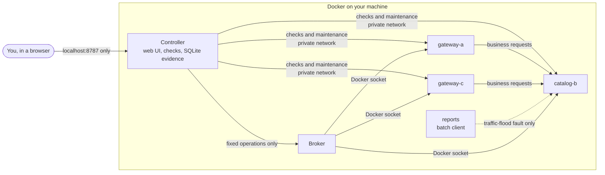

# AegisRack

A hands-on lab for practising Linux service troubleshooting. Three small web services run in Docker containers: two gateways that both depend on one shared catalogue. The lab breaks one of them on purpose, and you find out what went wrong from real measurements, choose a fix, and watch the lab verify whether the service really came back.

> **Two ways to try it**
> - **[Browser simulator](https://choochootrain23.github.io/aegis-fault-lab/)**: opens in any browser with nothing to install. **Nothing in it is real**: services and measurements are generated in your tab.
> - **[Full lab](#quick-start)**: real containers, real failures and measured evidence on your own Linux machine. About 10 minutes to set up.

**Status:** a working milestone. Eighteen fault types run on real Docker and are validated end to end, with an optional AI investigator that reads only the evidence on the page. See [limitations](#limitations).

## Contents

1. [What makes it different](#what-makes-it-different)
2. [Quick start](#quick-start) and [starting and stopping the lab](#start-and-stop-the-lab)
3. [What you practise](#what-you-practise): [the eighteen faults](#the-eighteen-faults) and [the thirteen checks](#the-thirteen-checks)
4. [Your first investigation](#your-first-investigation)
5. [Optional AI investigator](#optional-ai-investigator)
6. [Everyday use and troubleshooting](#everyday-use-and-troubleshooting)
7. [How it works](#how-it-works)
8. [Validation and development](#validation-and-development)
9. [Limitations](#limitations) and [further reading](#further-reading)

## What makes it different

- **Real failures, real evidence.** A stopped container is really stopped; a full disk really fails writes with `ENOSPC`; packet loss is a real kernel queue dropping real packets; a memory leak really ends in the kernel's out-of-memory kill. Every check result is a stored measurement you can open and cite.
- **Faults have look-alikes.** Packet loss resembles network delay, a zero quota or a bad release resembles config drift, a crash-looping leak resembles a stopped service. The fix for the look-alike reports *nothing changed*, so guessing does not pay.
- **Recovery must be proven.** An accepted fix is not proof. The lab credits recovery only after three healthy cycles in a row, or ten if the failure has already come and gone on its own, so a lucky moment cannot pass a wrong fix.
- **Safe by design.** The web page never touches Docker. A separate broker accepts twelve fixed operations on three named containers, and every service runs read-only, unprivileged and resource-capped.

## Quick start

You need **Linux** (or WSL2 with Ubuntu on Windows; macOS is untested), **Docker Engine with Compose v2**, **Python 3.10+** and `git`, plus about 2 GiB of free memory and 10 GiB of free disk where Docker stores its data.

```bash
git clone https://github.com/choochootrain23/aegis-fault-lab.git
cd aegis-fault-lab
python3 scripts/preflight.py     # read-only checks; should end with "Preflight passed"
python3 scripts/init_env.py      # writes three random credentials to .env, without printing them
docker compose up -d --build     # first build takes a few minutes
```

Open **http://localhost:8787**. The page collects a healthy baseline (a 0/5 meter); after about ten seconds all three services turn **healthy** and **Start investigation** turns green. Press the yellow **TOUR** button for a 60-second guided look.

### Start and stop the lab

Run these from the project folder.

| To | Run | What happens |
| --- | --- | --- |
| **Start** (first time, or after `git pull`) | `docker compose up -d --build` | Builds the image and starts all six containers |
| **Start** (any other time) | `docker compose up -d` | Starts the containers again; your investigation history is still there |
| **Check it is running** | `docker compose ps` | Lists six running containers; then open http://localhost:8787 |
| **Pause** | `docker compose stop` | Stops the containers but keeps them; `docker compose up -d` resumes |
| **End** | `docker compose down` | Removes the containers and networks; history is kept in a Docker volume |
| **End and wipe history** | `docker compose down -v` | Also deletes the volume, so every past investigation is gone |

**Before you end the lab,** finish any investigation on the page: press **End & reset** and wait for the healthy baseline. Otherwise an injected fault, such as a stopped service or a network rule, can still be in place when you next start. Only this project's containers, networks and volume are touched.

The details of each step follow.

### 1. Install Docker

On Ubuntu, follow [Docker's official guide](https://docs.docker.com/engine/install/ubuntu/), then its [post-installation step](https://docs.docker.com/engine/install/linux-postinstall/) so your user can run `docker` without `sudo` (log out and back in afterwards). Membership of the `docker` group is equivalent to administrator access on that machine. Check it works with `docker run --rm hello-world`.

### 2. Preflight

`scripts/preflight.py` only reads: it checks free memory, free disk for Docker's storage and the project folder, and that Docker supports the resource limits the lab relies on.

### 3. The `.env` file

`scripts/init_env.py` creates `.env` in the project folder. It never changes values that are already there, so running it again after an upgrade only adds what is missing. Docker Compose reads `.env` when the containers start, and each value goes only to the containers that need it.

| Variable | Set by | Purpose |
| --- | --- | --- |
| `AEGIS_BROKER_TOKEN` | `init_env.py` | Lets the controller talk to the broker, the only component with Docker access |
| `AEGIS_FLEET_TOKEN` | `init_env.py` | Protects the services' maintenance endpoints used to inject and remove faults |
| `AEGIS_SIGNING_KEY` | `init_env.py` | Shared by the catalogue and the gateways only, to sign and check the gateways' requests. Without it signing is off, every traffic report says so, and the clock-skew scenario is refused. After upgrading, run `init_env.py` again to add it |
| `AEGIS_AI_PROVIDER` | you, optional | `gemini` (default) or `anthropic`; see [AI investigator](#optional-ai-investigator) |
| `AEGIS_AI_API_KEY` | you, optional | Your own model API key; the AI panel stays off without it |
| `AEGIS_AI_MODEL` | you, optional | Overrides the model; leave it out to use the default |
| `AEGIS_STORAGE_LIMIT_MIB` | you, optional | Evidence storage budget in MiB (default 256) |

A complete `.env` with the AI turned on looks like this (values shortened):

```bash
AEGIS_BROKER_TOKEN=3f9a…   # generated; do not edit
AEGIS_FLEET_TOKEN=b71c…    # generated; do not edit
AEGIS_AI_PROVIDER=gemini
AEGIS_AI_API_KEY=…         # your key, no quotes or spaces
```

Keeping it safe:

- `.env` is in `.gitignore`, so git never commits it (`git check-ignore .env` prints `.env`).
- `init_env.py` makes it readable only by you (mode 600). If you created it yourself, run `chmod 600 .env`.
- Never paste its contents into an issue, a chat or a screenshot. If a key leaks, revoke it with its provider and create a new one.
- After editing `.env`, run `docker compose up -d`; it recreates only the containers whose settings changed.
- The published browser simulator never uses `.env` or any key.

### 4. Build, start and open

`docker compose ps` should list six running containers: `controller`, `broker`, `gateway-a`, `catalog-b`, `gateway-c` and `reports` (an idle batch client and app-user simulator, used only by the faults that need outside traffic: the traffic flood, the retry storm, thermal throttling and the compound incident).

**Lab inside a VM or on another machine?** Forward the port from the computer you browse on: `ssh -L 8787:localhost:8787 you@lab-machine`, then open http://localhost:8787 there. In VS Code Remote-SSH, the **Ports** panel can forward 8787 for you. Use `localhost`, not an IP address: the lab deliberately rejects other addresses.

## What you practise

The core skill is **finding the boundary of a failure**. Both gateways call the shared catalogue, so a fault on the catalogue reaches both gateways, while a fault on one gateway stays local and the other gateway stays healthy. Comparing the two gateways is the quickest first step.

### The eighteen faults

Eight faults can target any of the three services. The zero quota and the traffic flood only exist on the shared catalogue, which enforces quotas and is the one service a batch client calls directly; the retry storm, the DNS failure, the partial partition and clock skew only exist on a gateway, where app users arrive and which resolves, calls and signs its requests to the catalogue; the rack power loss is named by the catalogue's rack, R1, which it shares with gateway-a; thermal throttling affects the whole room, so it is named by the catalogue too; the brownout hits rack R2, where gateway-c is the only service; and the heatwave with a retry storm is named by the gateway the app users storm.

| Fault | What you see | Evidence that gives it away | Look-alike | Fix |
| --- | --- | --- | --- | --- |
| **Stopped service** | Its own checks fail; on the catalogue, the gateways stay live but their requests fail | **Container state** reads stopped | Config drift on a gateway | **Start service** |
| **CPU starvation** | Everything still answers, just slowly (above 300 ms) | **Resource use** shows CPU at the container's limit with throttling; logs record a job starting | Network delay | **Stop runaway job** |
| **Disk full** | The process stays live, but requests fail with HTTP 507 | **Disk usage** shows `/tmp` full, with one large filler file | | **Clear temp files** |
| **Config drift** | Liveness, CPU and disk look normal, yet requests fail | **Running config** shows a setting that differs from what was deployed; **Request trace** shows which step fails | A stopped catalogue | **Restore config** |
| **Network delay** | Everything answers about 600 ms late, with idle CPU | **Network path** shows connections taking about 600 ms and a `netem` delay queue | CPU starvation | **Remove traffic delay** |
| **Packet loss** | Intermittent: the same request is sometimes instant, sometimes 200–600 ms late, sometimes a timeout | **Network path** shows a `netem` queue dropping 50% of packets and many resent TCP segments | Network delay | **Remove packet loss** |
| **Quota set to zero** | Both gateways fail with HTTP 429, yet the catalogue is up, fast and green to its own health checks | **Traffic & quotas** shows each gateway rejected against a limit of 0 per second, pushed by the quota system | Config drift (the running config is unchanged) | **Reset client quotas** |
| **Bad release** | About half of business requests fail with HTTP 500 (`TypeError`); the machine looks fine | **Release history** shows v1.5.0 deployed just before the errors; logs name the version | Config drift (the running config is unchanged) | **Roll back release** |
| **Traffic flood** | Everything is slow: the catalogue's checks and both gateways' requests take about half a second, though nothing fails | **Resource use** shows the catalogue's CPU at its limit, but its logs show no job; **Traffic & quotas** shows one caller, report-exporter, sending about 480 requests a second with no quota | CPU starvation (there is no runaway job to stop) | **Rate-limit top client** |
| **Retry storm** | One gateway fails almost every request, long after a short slowdown in the catalogue has ended; the other gateway and the catalogue are fine | **Resource use** shows that gateway at its CPU limit while the catalogue idles; **Traffic & quotas** on it shows most requests are retries | A traffic flood, or a broken gateway (nothing is broken) | **Enable load shedding** |
| **Rack power loss** | The catalogue and gateway-a stop at the same moment, and starting either reports no power | **Facility** (simulated) shows the PDU-A breaker open and every service it feeds | Two separate stopped services | **Reset breaker** |
| **Thermal throttling** | Both gateways turn slow even to liveness checks and fail most requests, while the catalogue stays fast | **Resource use** shows each gateway's CPU limit at 0.05 instead of the deployed 0.25; **Facility** (simulated) shows a failed cooling unit, the inlet at 38 °C and a power cap | CPU starvation (there is no job to stop) | **Lift power cap**, refused until cooling recovers after about 75 s |
| **Clock skew** | One gateway fails every request with an upstream HTTP 401, while the catalogue and the other gateway are healthy | The business request names `RequestExpired`, a timestamp 300 s ahead of the catalogue's clock; **Network path** on that gateway shows its clock 300 s from the controller's, set by a time daemon that chose a bad source; its own log entries carry times in the future | A bad release or config drift (both unchanged); a zero quota (that is HTTP 429, not 401) | **Resync clock** |
| **Brownout** | gateway-c crash-loops: up about 10 s, down about 6 s, again and again; the catalogue and gateway-a are fine | **Facility** (simulated) shows feed A to PDU-B sagging to 186 V, below the 200 V its power supply needs, the redundant feed B normal, and a power-supply dropout at every restart; **Memory** stays flat with no out-of-memory kill | A memory leak (memory is flat, the release unchanged); a stopped service (starting it lasts only until the next dip) | **Move to redundant feed** |
| **Partial partition** | One gateway's requests all time out after 1 s, while the catalogue and the other gateway are healthy | **Network path** on that gateway shows a filter under a `prio` queue dropping every packet to the catalogue's address, and a TCP connection from the gateway to that address getting no answer; its DNS lookup still works | A stopped catalogue (it is up), packet loss (no `netem` queue; all traffic to one destination is lost), a DNS failure (the name resolves) | **Restore route** |
| **Heatwave and retry storm** (compound) | Both gateways fail under a power cap; lifting it, once cooling recovers, restores one gateway but the other keeps failing | **Facility** (simulated) shows the failed cooling unit and the cap; under the cap the stormed gateway cannot even answer its checks while the other still can; once the cap is lifted, **Traffic & quotas** on it shows most recent requests are retries | Thermal throttling (lifting the cap is not enough); a retry storm (shedding alone cannot beat the cap) | **Lift power cap** once cooling recovers, then **Enable load shedding** on the stormed gateway |
| **DNS failure** | One gateway fails every request, while the catalogue and the other gateway are healthy | **Network path** on that gateway shows its lookup of `catalog-b` refused by nameserver 127.0.0.53, set by a settings sync instead of the deployed 127.0.0.11, while a TCP connection to the catalogue's last known address still succeeds; **Request trace** fails at the DNS lookup | A stopped catalogue, or config drift (the running config is unchanged) | **Restore resolver** |
| **Memory leak** | The service crash-loops: healthy for about 14 s, then killed, then restarted | **Memory** shows growth of about 12 MiB/s towards the 192 MiB limit and the last exit as an out-of-memory kill; **Release history** shows v1.5.1 re-deployed after every restart | A stopped service (starting it only begins the next loop) | **Roll back release** |

The packet-loss rate is deliberately extreme. Real links already hurt at 1–2% loss; 50% makes the effect show within a minute. The zero-quota fault is inspired by public reports of the December 2020 Google authentication outage, where a quota system reduced capacity to zero. The release faults start a rollout: while it lasts, a **deploy controller** keeps the new version running, restarting a crashed service after three missed health cycles and re-applying the release, as an orchestrator such as Kubernetes would. Rolling back ends the rollout. The traffic flood comes from a separate small `reports` service on the internal network, whose export job honours `Retry-After` with jitter once it is rate-limited, as a well-behaved client should. The retry storm is a metastable failure, the pattern behind many cascading outages: app users retry every failure at once, so an 8-second compaction in the catalogue tips one gateway into an overload that sustains itself. The facility layer is a clearly labelled simulation: containers have no power supply, so racks, PDUs and breakers are modelled, but a tripped breaker really stops the containers it feeds, and they really stay down until it is reset. Thermal throttling uses the same layer: a simulated cooling failure, a real power cap on every container's CPU and real daytime users, because a cap alone barely slows these light requests (measured: a 2 ms median even at 0.02 CPU). The DNS failure uses real name resolution: each gateway sends its own DNS queries to Docker's resolver and caches each answer for 5 seconds. The fault points the resolver at 127.0.0.53, systemd-resolved's address on an ordinary Linux host, a setting easily copied from a host image, where nothing listens inside a container. A stopped catalogue's name stops resolving too (Docker's resolver answers SERVFAIL for a stopped container), but then the resolver is unchanged and the catalogue cannot be reached at all. The brownout uses the facility layer too. The voltage is simulated; the restarts are real, as the lab stops the container at each dip and starts it again a few seconds later. A container has no power supply to lose, so it stops cleanly. The partial partition uses the same short-lived network helper as the delay and the loss, with one more fixed rule: a `prio` root queue and a single `u32` filter that drops packets to the catalogue's address, which the broker reads from Docker itself. Clock skew depends on request signing: each gateway signs its calls to the catalogue with an HMAC over the request and a timestamp, and the catalogue refuses a missing or forged signature, or a timestamp more than 30 s from its own clock, so a captured request cannot be replayed later. Containers share the host's kernel clock, so the fault offsets the gateway process's own clock rather than the machine's; deadlines are still measured on the shared kernel clock. The heatwave with a retry storm is a compound incident: two causes, two fixes in order. A correct first fix that leaves a service failing is recorded as a real success, and the verification line says from the measurements which services it restored and which still fail; recovery is only verified once every service is healthy. Planned faults (more compound incidents) are listed in the [scenario roadmap](docs/scenario-roadmap.md).

**Practice** mode tells you the fault and lets you choose the service. **Challenge** mode picks both at random and hides them until you reveal them or end the attempt. The 15-minute timer can be extended; if it runs out and you do not respond within 60 seconds, the lab resets itself, even with the browser closed.

### The thirteen checks

Select a service on the live map, then run any check, in any order. Each result goes into the **evidence notebook**, where you can open the raw measurement and tick it as evidence for your diagnosis.

| Check | What it measures |
| --- | --- |
| **Process liveness** | Whether the process answers at all |
| **Business request** | Whether a full request succeeds, and how long it takes (slow above 300 ms) |
| **Container state** | Running or stopped, from Docker through the broker |
| **Resource use** | CPU against the container's limit, and kernel throttling |
| **Disk usage** | Free space on `/tmp` and the largest files |
| **Running config** | Live settings next to what was deployed |
| **Request trace** | Where one request spends its time: the upstream call, the receipt write, and time outside the handler |
| **Network path** | Three timed TCP connections, the service's own queue settings (`tc qdisc show`), how many TCP segments it resent, its clock against the controller's (estimated over the request, as NTP does) and, on a gateway, any packet filters, a fresh DNS lookup of the catalogue and a TCP connection to it from the gateway |
| **Service logs** | Recent failures and events, such as a job starting or a config reload |
| **Traffic & quotas** | Requests per caller over the last minute, rejections and errors, and the per-caller quotas the service enforces |
| **Release history** | The running version, and every version deployed to this process, by whom and when |
| **Memory** | How the container last exited (including out-of-memory kills, from Docker) and, while it runs, memory against its limit over the last minute |
| **Facility** *(simulated)* | The rack, power feed (PDU), breaker, load and inlet temperature of a service, and every service sharing that feed |

## Your first investigation

1. Leave **Mode** on **Practice · known fault**, **Fault** on **Stopped service** and **Target** on **Catalogue (shared)**, then press **Start investigation**. The lab really stops the `catalog-b` container.
2. Within about six seconds the live map changes: both gateways turn **degraded** (alive, but their requests fail) and `catalog-b` turns **unavailable**. Both gateways failing at once points at what they share.
3. Click a service and run its checks. The **Suggested next** card always offers a sensible next step, but you can explore in any order.
4. Stuck? **A little direction?** offers an explanation of the evidence, a hint pointing at the next check, or one suggested action. Help is optional and recorded.
5. Select a service and choose a fix. Trying the wrong one is allowed: it reports that nothing changed and is recorded. Then watch verification: **three healthy, fast cycles in a row**, or **ten** if the failure had already come and gone on its own, before **Recovery verified**.
6. Optionally write your diagnosis, ticking the evidence that supports it, then press **End & reset** to restore every service. The **incident report** shows how long detection, checks and recovery took, and **Replay** animates every request over time. Past investigations stay in **Investigation history**.

**Keyboard shortcuts:** **A**, **B** and **C** select gateway-a, catalog-b and gateway-c; **1**–**9** and **0** run the selected service's first ten checks (the rest are a click away); **E** explains the evidence; **P** pauses the notebook; **?** lists them all. Nothing that changes the services has a shortcut.

**No install?** The [browser simulator](https://choochootrain23.github.io/aegis-fault-lab/) runs the same page against a JavaScript copy of the controller's rules, calibrated against measurements from the real lab. It is clearly marked **SIMULATION** and resets when you reload.

## Optional AI investigator

The **AI investigator** card answers questions about the evidence, citing the observations it relies on. It is off by default and nothing is sent anywhere until you add a key. It receives only what the page already shows (evidence summaries and service health), never the hidden fault, and it cannot run checks or change anything. Its answers count as help in the incident report.

To turn it on, add a provider's lines to [`.env`](#3-the-env-file), then run `docker compose up -d`.

**Gemini (free tier).** Create a key in [Google AI Studio](https://aistudio.google.com/apikey):

```bash
AEGIS_AI_PROVIDER=gemini
AEGIS_AI_API_KEY=your-gemini-key
```

The default model is `gemini-3.5-flash-lite`. Google has closed `gemini-2.5-flash-lite` to new keys, so remove any `AEGIS_AI_MODEL` line that still names it.

**Claude (paid, low cost).** Create a key in the [Claude Console](https://console.anthropic.com/) and choose the fastest, cheapest model:

```bash
AEGIS_AI_PROVIDER=anthropic
AEGIS_AI_API_KEY=your-claude-key
AEGIS_AI_MODEL=claude-haiku-5-5
```

Without `AEGIS_AI_MODEL`, Claude defaults to `claude-opus-5-5`, which is more capable but costs more. With Haiku 5.5, one answer costs well under a tenth of a cent.

Once set up, the card's badge reads **ON · gemini** (or **ON · anthropic**). Each investigation allows 30 questions; answers usually take 5–10 seconds and are capped at about 180 words. Check what an answer cites before acting on it.

## Everyday use and troubleshooting

To start, pause or end the lab, see [Start and stop the lab](#start-and-stop-the-lab). **Upgrading?** `git pull`, `python3 scripts/init_env.py` (adds any new credential), then `docker compose up -d --build`.

If the page stops responding mid-investigation, bring the services back with `docker compose start catalog-b gateway-a gateway-c` and `docker compose up -d controller broker`, then reopen the page and press **End & reset** so the lab re-verifies a healthy baseline.

| Symptom | What to do |
| --- | --- |
| `permission denied ... docker.sock` | Your user cannot use Docker yet. Follow Docker's post-installation step, log out and in, then retry. Do not `chmod` the socket. |
| `Run scripts/init_env.py first` | `.env` is missing or lacks a newer credential. Run `python3 scripts/init_env.py`, then `docker compose up -d`. |
| `port is already allocated` on 8787 | Something else uses port 8787. Stop it, then `docker compose up -d` again. |
| Page says **Untrusted host** | Browse to `http://localhost:8787` (or forward the port) rather than an IP address. |
| Services stay **Unknown** | Run `docker compose ps`; all six containers should be running. `docker compose logs controller` shows errors. |
| Preflight reports low memory | Close other programs and retry. The lab needs about 2 GiB free. |
| *Evidence storage limit reached* (HTTP 507) | Export any evidence you want, then press **Run retention cleanup**. To allow more, set `AEGIS_STORAGE_LIMIT_MIB` in `.env` and run `docker compose up -d`. |
| AI: *still the placeholder* | `AEGIS_AI_API_KEY` still holds the example value. Paste your real key, then `docker compose up -d`. |
| AI: *HTTP 404* | The model is unknown or retired for your key, for example `gemini-2.5-flash-lite`. Delete the `AEGIS_AI_MODEL` line. |
| AI: *HTTP 400/401/403* or *rejected the key* | The key is wrong, revoked or for the other provider. Check `AEGIS_AI_PROVIDER` matches it. |
| AI: *rate limit* or *took too long* | The provider is busy or your free-tier limit was reached. Wait a minute and ask again. |

## How it works



**The services.** gateway-a, gateway-c and catalog-b are small Python web services. Every business request writes a small receipt to the service's 8 MiB `/tmp`, so a full disk causes real write errors. Each gateway identifies itself to the catalogue, which enforces a per-caller quota; the controller's health probes have no quota, which is how a quota fault can hide behind green monitoring.

**The controller** serves the page, runs health checks every two seconds and stores every observation as evidence in SQLite. Its rules:

- A fault can only start from five healthy baseline cycles.
- An investigation opens once three of the last five cycles fail, so intermittent faults are caught as well as steady ones.
- Recovery counts only after three consecutive healthy cycles, or ten once the failure has come and gone on its own (the first recovery after a fix does not count as that).
- During a release fault, a deploy controller restarts a crashed service after three missed cycles and re-applies the release, using the same broker and maintenance operations as everything else, until a rollback ends the rollout.
- Actions are recorded before they are sent; after a restart, an unconfirmed action is marked *unknown* and never replayed.

**The broker** is the only part that can touch Docker. It accepts twelve fixed operations on the three named containers (inspect, read resource use, start, stop, add or remove the traffic delay, add or remove the packet loss, set the CPU limit to exactly 0.05 or back to exactly 0.25 for the power cap, and add or remove the partition filter, which drops only traffic from a gateway to the catalogue address the broker reads from Docker) and checks each container's identity and security settings first.

**Network faults** are applied by a short-lived helper container that the broker starts inside the target's own network namespace. The helper has only the `NET_ADMIN` capability, no mounts and a read-only filesystem, runs one fixed `tc` command and is removed straight away. Removal deletes only a queue with exactly that fault's settings, so removing the delay leaves a loss queue alone (and the reverse), and anything else is refused.

**Other faults** (CPU, disk, config, quota, releases and the flood) are injected and cleared through maintenance endpoints inside each service, protected by a separate token. Filling refuses to run unless `/tmp` really is a small bounded tmpfs, and never writes more than 16 MiB. The leaky release never holds more than 512 MiB, and the container's 192 MiB limit stops it long before that: the kernel's out-of-memory kill stays inside the container.

**Overload safety.** Every request carries a deadline (`X-Aegis-Deadline`), and a service that reaches a request after its caller has given up drops it unanswered rather than doing the work; gateways pass the tighter deadline on to the catalogue. Each gateway limits its own calls to the catalogue (a bulkhead), and containers allow 65,536 open files. Without these, an overload left the services busy for minutes after it ended.

**Isolation.** The service containers run read-only, as a non-root user, with no Linux capabilities, capped memory and CPU, and no ports open to your network. The page listens on `localhost` only and rejects other hosts and cross-origin requests.

**Evidence and storage.** Detailed records are kept for 24 hours, and evidence for an active investigation is protected. Ended summaries remain for 30 days. Exports put cited observations first, plus recent detail within 8 MiB, and report anything omitted.

Challenge secrecy is a learning boundary, not an exam lock: whoever controls Docker on the machine can see which container changed. More in [architecture](docs/architecture.md) and the [fault catalogue](docs/fault-catalogue.md).

## Validation and development

What has been checked on real Docker is recorded, with dates and numbers, in [validation](docs/VALIDATION.md). In short:

- **Scenario matrix:** every fault on every service it can target, challenge rounds until every fault and service has appeared, and a reset without recovery. Each round identifies the fault from evidence alone, confirms that wrong and look-alike fixes change nothing, and verifies recovery.
- **Soak:** a two-hour run passed 157 of 157 rounds with flat controller memory.
- **Failure handling:** a controller killed mid-action, and the unattended 15-minute expiry.
- **AI evaluation:** 30 hidden-fault rounds with `gemini-3.5-flash-lite`.

### Backend tests

```bash
python3 -m venv .venv
.venv/bin/python -m pip install -r requirements.lock
.venv/bin/python -m pytest -q
AEGIS_PROCESS_TESTS=1 .venv/bin/python -m pytest -q   # also starts two real service processes
```

Workflow tests use explicit test doubles; the shipped runtime has no fake fleet mode. The optional process test starts two temporary services on loopback and checks real HTTP effects; it does not prove Docker or network isolation. Run one controller per state database; a file lock rejects a second.

### Validation scripts (real Docker)

Each `--run` script deliberately interrupts the project's services, refuses to start while an investigation is active, and writes its report to the ignored `state/validation/` folder. Do not use the lab while one runs.

| Command | What it does |
| --- | --- |
| `python3 scripts/validate_scenarios.py --run` | The full scenario matrix; `--kinds packet-loss,quota-zero` runs only some faults, in practice |
| `python3 scripts/validate_f1.py --run` | The original stopped-service walkthrough, three rounds |
| `.venv/bin/python scripts/verify_runtime.py` | Actual container limits and the broker contract |
| `python3 scripts/soak.py --run --hours 2` | Random practice and challenge rounds for the given time, recording memory, storage and collector errors |
| `python3 scripts/evaluate_ai.py --run --rounds 30` | Grades the AI investigator on hidden faults (needs a key; every question is a real model call) |

### Browser tests

These need Playwright (validated with 1.64.0): `.venv/bin/python -m pip install playwright==1.64.0`, then `.venv/bin/python -m playwright install chromium --only-shell`.

| Command | What it covers |
| --- | --- |
| `.venv/bin/python tests/preview_walkthrough.py` | The browser simulator: practice, challenge, every fault, report replay, tour and live map. `AEGIS_BROWSER=firefox` or `webkit` runs it in Firefox or Safari's engine (after `playwright install firefox webkit`; WebKit on Linux also needs `playwright install-deps webkit`) |
| `.venv/bin/python tests/accessibility_audit.py` | An axe-core audit of the page in six states; fails on serious or critical violations. Needs `axe.min.js` (axe-core 4.10.2) in `state/ui-tools/axe/` |
| `.venv/bin/python scripts/validate_browser.py --run` | Challenge secrecy, controller restart mid-investigation, diagnosis and recovery through the UI, against the real lab |
| `.venv/bin/python tests/browser_review.py` | Desktop and phone layouts, archive, citations and keyboard use (needs port 8787 free) |
| `.venv/bin/python tests/browser_workflow.py` | The active workflow against two real service processes, with accelerated timing (needs port 8787 free) |

`node tests/view-model.mjs` runs the pure UI-logic checks if Node.js is installed. `scripts/record_demo.py` records a captioned demo video of the simulator to the ignored `state/demo/` folder.

### Browser simulator

The simulator is published by `.github/workflows/pages.yml` on every push to `main`. To build and view it locally:

```bash
python3 scripts/build_preview.py            # writes the ignored site/ folder
python3 -m http.server -d site 8000         # then open http://localhost:8000
```

The build copies `web/` unchanged apart from relabelling every real-measurement claim, and fails if an expected label is missing. A test keeps the simulator's debriefs identical to the real lab's.

## Limitations

- **Scope:** containers share one kernel and the business data is synthetic. Nothing here claims physical hardware repair; planned power and cooling scenarios would use clearly labelled simulated telemetry.
- **AI investigator:** optional and off by default. In 30 hidden-fault rounds with `gemini-3.5-flash-lite` (before the eight newest faults were added) it named the correct fix every time once all inspections had been run, but once guessed too early from thin evidence. Other models are unevaluated. Treat answers as suggestions and check what they cite.
- **Not yet validated:** screen-reader use (the automated axe audit passes, but it cannot judge everything). The simulator passes automatically in Chromium, Firefox and WebKit, and has been checked by hand in Safari.

## Further reading

- [Validation](docs/VALIDATION.md): what was measured on real Docker, and what each test layer does and does not establish
- [Scenario roadmap](docs/scenario-roadmap.md): the planned faults and their look-alikes
- [Fault catalogue](docs/fault-catalogue.md) and [architecture](docs/architecture.md)
- [Interview walkthrough](docs/interview-walkthrough.md): one fault end to end, the privilege trade-off, a restart failure, the AI's uncertainty, and a retry storm that outlived its cause
- [Example incident exports](docs/examples/) from real challenge runs
- [Implementation checkpoints](docs/IMPLEMENTATION_STATUS.md), [vision](docs/vision.md) and [roadmap](docs/roadmap.md)

Fonts in `web/fonts/` (Archivo, Inter, Geist Mono, Instrument Serif) are self-hosted under the SIL Open Font License; see `web/fonts/LICENSES.txt`.
