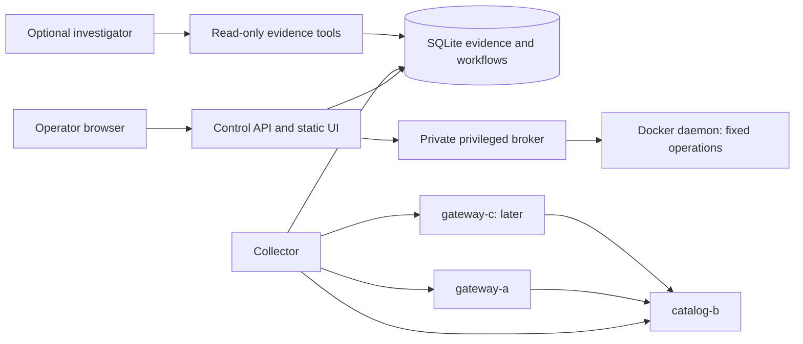

# Architecture proposal

Status: review draft, 20 October 2026. Design targets below are not benchmark results.

## Initial environment inspection (historical)

Read-only inspection used `ls`, workspace README, `uname`, `/etc/os-release`, `lscpu`, `free -h`, `df -h`, `systemd-detect-virt`, device/module checks, `id`, cgroup files, and Docker version/info/Compose/list commands. No installs, elevated commands, configuration changes or container mutations were performed.

| Observation | Result and implication |
| --- | --- |
| Workspace | `new-project/` was empty. Sibling `server-emergency-room/` exists; no source reused or changes made there. No applicable ancestor or new-project AGENTS.md was found. Sibling instructions are outside scope. |
| OS/kernel | Ubuntu 26.04.1 LTS, x86_64, kernel `7.0.0-38-generic` |
| CPU | 4 online CPUs, VMware hypervisor reported by `lscpu` |
| Memory | 7.2 GiB total, 4.5 GiB used, 2.7 GiB available at inspection |
| Swap | 4.0 GiB total, 2.4 GiB used: avoid assuming idle capacity or running a local model |
| Storage | Root/project filesystem 145 GiB total, 118 GiB available; `/tmp` is a separate 3.7 GiB tmpfs, so do not stage large images there |
| Docker | Client 29.1.3 and Compose 2.40.3 installed; socket exists, but daemon queries return permission denied. Server version, running workloads, storage driver and resource enforcement are unknown. Empty/default fields emitted by failed `docker info` are not evidence of daemon capabilities. |
| Nested virtualisation | No `vmx`/`svm` CPU flags, no visible `/dev/kvm`, no visible KVM module paths. Hardware-accelerated nested VMs are unavailable to this session. VMware host support/settings are not established. |
| Execution view | `systemd-detect-virt` reports `container-other` despite VMware CPU information. This is a restricted execution view, not necessarily the user's direct VM terminal. Cgroup effective limits could not be established from the accessible root files. |

Repeat the relevant checks in the intended execution terminal before implementation. Do not change Docker socket permissions or group membership as part of documentation. If daemon access remains unavailable, stop the runnable milestone and document the blocker rather than substituting fake measurements.

**Deployment update, 20 October 2026:** refreshed login membership restored Docker access without changing socket permissions. Docker 29.1.3 now runs the project. Preflight found 4.45 GiB available RAM and 117.4 GiB free storage. Three production fault/recovery/reset rounds and actual fleet cgroup/privilege checks passed; see [validation](VALIDATION.md).

The controller additionally joins a dedicated non-internal operator bridge because publishing a localhost port did not take effect when all its networks were internal. Host publishing remains `127.0.0.1:8787`; the fleet and broker remain exclusively on their internal project networks. The operator bridge permits controller outbound connectivity. The shared image is built once, avoiding concurrent publication of the same tag by four services.

## Starting approach

| Choice | Fit for this machine/project | Decision |
| --- | --- | --- |
| Docker Compose containers | Low overhead; real Linux processes, isolated network/filesystem views, reproducible services and resource caps. Shared kernel; limited systemd/hardware fidelity. Daemon access is a prerequisite. | Start here with two nodes, expand to three. |
| Manually managed network namespaces | Excellent for Linux networking exercises and low overhead, but namespaces alone do not isolate storage/processes or bound resources. Requires privileged lifecycle, links, routes, cleanup and separate cgroup management. | Defer; container networking already uses namespaces. |
| Nested VMs | Separate kernels, boot/service-manager realism; higher memory/storage demand and longer setup. KVM is not exposed and memory headroom is low. Software emulation would compromise the interactive demo. | Do not start here; reconsider only for a specific full-OS learning objective on a better provisioned environment. |

Use Python/FastAPI for control APIs and small synthetic services, Docker Compose for local lifecycle, SQLite for control-plane state, and plain HTML/CSS/JavaScript with SVG for topology. Polling every two seconds is enough initially; avoid a frontend framework or streaming stack until needed. Pin dependency/image versions during implementation, not by inventing lockfiles in this design phase. No Kubernetes, Redis, extra database, Grafana, Jaeger, BGP or PXE requirement is established.

## Components and data flow

UI review decision: topology-centred, muted background with colourful measured-state interactions, selected-node diagnostic actions, persistent evidence/timeline drawer and collapsible AI panel. Detail design is delegated. Use gentle finite pulses for requested evidence assistance rather than rapid/repeating flashes; respect reduced-motion preferences and pair colour with labels/icons. Ordinary incident alerts must be visually distinct from optional solution hints. No hidden-fault cues in unaided challenge mode. Optional diagnosis entries contain explanation, evidence and uncertainty; evidence IDs are validated, but AI feedback is advisory rather than a correctness certificate.

The controller runs the API, collector and single SQLite writer in one modest container/process group. The private broker is a separate trusted component, reachable only by the controller, with Docker socket access. Fleet nodes are on a dedicated project bridge; no fleet service is published to the VM. The controller can probe that bridge and reach the broker on a separate control network. Fleet nodes cannot reach the broker. The initial two-node dependency is A → B; third node C → B makes shared-failure patterns visible. A fourth node is deferred unless it creates a useful new diagnosis.

Gateway `/live` reports its own process health. `/ready` performs a bounded B request; `/summary` executes a real synthetic business request. B exposes liveness, read and bounded synthetic-write endpoints. Requests carry correlation IDs. One fixed-rate collector generates at most one business request per gateway per probe cycle, plus probes. Do not run unbounded load generators.

Inventory stores stable logical IDs, expected service roles and configured dependencies. Edges are marked `configured` until real request evidence exists; traffic animation and error counts use measured requests. Nodes show separate live/ready state, container generation and sample age. A missing sample becomes `unknown`, not healthy or failed. CPU/memory values are labelled container-scoped; VM-wide values, if later collected, appear separately.

## Evidence and workflow contracts

SQLite records nodes, samples, incidents, evidence, actions, investigations, tool calls and report revisions. Each observation includes immutable ID, source/node, container generation, collection time in UTC, optional source time, outcome, bounded payload and truncation flag. Use monotonic time for durations; source clocks are not assumed authoritative. UI may display Singapore time while retaining UTC exports.

Probe every 2 seconds with a 1-second timeout and no overlapping cycles per target. Open an incident once three of the last five probe cycles have failed (so an intermittent fault such as packet loss is caught as well as a steady one); a stopped-container sample can annotate it immediately. Mark telemetry stale after 6 seconds without a completed observation. Correlate A/C symptoms when they share B and failures occur within a 10-second window; describe this as a candidate shared dependency incident, not proven causality.

Incident states: `open → investigating → recovery_pending → verifying → recovered`; failed verification returns to `investigating`. Unknown observations cannot satisfy recovery. Require three consecutive successful B checks and end-to-end requests for each affected gateway, with no new relevant error in that verification window. If a failure has come and gone on its own during the investigation, require ten instead: under an intermittent fault three healthy cycles can be luck, and a wrong fix must not be credited. The first recovery after a recovery action does not count as coming and going. A sixth container, `reports`, is a batch client used only by the traffic-flood fault: it holds no credentials but the fleet maintenance token, calls only the catalogue on the internal network, and is never touched by the broker. During a release fault, the controller also acts as the rollout's deploy controller: it restarts a crashed target after three missed cycles through the broker's ordinary start operation and re-applies the release through the maintenance endpoint, until a rollback ends the rollout. Each restart uses the same identity checks as any other action. Observation timeouts have explicit error records.

Actions have requested/running/succeeded/failed/unknown status, target generation and an idempotency key. Persist intent before invoking the broker. On interruption, reconcile observed state; never blindly replay an ambiguous mutation. Allow one active fault/recovery action per incident and initially one active fault across the lab. Baseline/reset rechecks prerequisites and expected topology, removes only known project artefacts, then verifies health. Action acceptance and service recovery are separate facts.

## Trust and privilege boundaries

Review decisions: operator recovery controls do not require a correct diagnosis first; safe but unhelpful attempts are recorded and their effects verified. The user accepts the privileged-broker tradeoff for this local lab. Cloud transmission is permitted for bounded synthetic project evidence and investigation content, excluding secrets, unrelated host logs and employer material. The user plans to use an existing model subscription; provider and programmatic access remain unknown. The US$5 initial usage ceiling is provisional pending that check, and is not permission to purchase a subscription or assume API credits exist.

- Bind the web service to VM loopback initially. For Windows access, prefer an authenticated SSH tunnel. Direct VM-network publication is a later explicit setup choice requiring authentication and origin/CSRF protections, never a Docker API exposure.
- Web mutations require an operator session token, same-origin checks, validated scenario/target enums and idempotency keys. Keep credentials out of URLs and logs. Read-only AI credentials never authorize actions.
- Only the broker holds the Docker socket. Its authority is effectively host-level even if its application API is narrow; this is a single-user trusted lab, not a multi-tenant security boundary. A socket mounted read-only does not make Docker API operations read-only.
- Broker resolves static logical IDs against the expected Compose project label, service label and current container identity. Fail closed on ambiguity, generation mismatch or unexpected mount/network configuration. Never accept arbitrary container IDs, command strings, host paths, images, mounts or Docker API paths from clients.
- Allowed verbs are selected inspect/stats/log retrieval, stop/start known fleet containers, and fixed fault/reset routines with bounded parameters. No general exec endpoint. If a routine requires exec, its executable and argument list are broker-owned constants, never shell text. Control-plane containers cannot be fault targets.
- Normal nodes: non-root processes, dropped capabilities, read-only root filesystems, bounded writable mounts, PID/CPU/memory limits, no host networking or host PID namespace. The optional netem helper is exceptional: only `NET_ADMIN` inside the selected project network namespace, with fixed interface and qdisc operations. Never use host-network netem or `--privileged`.
- Diagnostic outputs and logs are untrusted content, including for AI. Parse and bound them; text that resembles instructions cannot expand tool authority. Separate action audit/ground truth from the diagnostic evidence view and AI context. Do not expose fault labels through scenario-named evidence IDs or metrics.

## AI contract (optional per run; required for portfolio)

Review update: AI is required in the finished portfolio but optional during any particular run. It may autonomously select bounded read-only checks after an operator asks it to investigate, with visible progress and interruption/redirection. Prefer a lightweight model subject to evaluation; integration/provider selection is being researched. Operator diagnostics must support freely ordered fresh checks as well as historical evidence queries. A fresh check runs through the collector's validated diagnostic interface, persists its result, and returns an evidence ID; it is not arbitrary execution. Tools explicitly identify cached versus fresh observations.

Tools: `get_topology()`, `get_incident(id)`, `get_health(node, window)`, `get_service_state(node)`, `get_logs(node, window, limit)`, `get_metrics(node, window)`, `get_evidence(ids)`. Historical queries read persisted observations; fresh diagnostic checks invoke the validated collector interface and persist evidence before returning. Cached service state can be up to one collector cycle old and must include age. No SQL input, arbitrary URLs, shell, Docker access or mutating tools. Restrict windows to retained incident data, log results to 200 lines/32 KiB, and all tool responses to 32 KiB with truncation markers.

Reports separate observations, hypotheses, supporting/contradicting evidence, unknowns, proposed operator checks and verified outcomes. Validate cited IDs and scope before displaying claims as evidence-backed; a citation existing does not prove that the model interpreted it correctly. Fault provenance is available only in a separate evaluator/operator audit view. The assistant may establish a dependency outage without knowing why the process stopped.

One investigation at a time; initial limits: 12 tool calls, 90 seconds, 12,000 total input tokens and 2,000 output tokens per investigation, subject to the selected provider's actual accounting. Persist calls, errors, duration and available usage. Unknown usage is unknown, not zero. Enforce limits before further calls. No local model on this VM. Offline/provider failure retains deterministic diagnostics and offers a manual report. An interrupted model call is marked unknown; continuation creates a recorded new attempt rather than claiming exactly-once billing.

## Resource and retention budget

### AI integration recommendation following review

Accepted provider direction: Gemini Developer API free tier with a lightweight model, subject to account eligibility and scenario evaluation. User accepts its product-improvement/human-review data terms for synthetic project evidence and investigation content. No automatic paid upgrade; preserve no-key/manual mode. The ChatGPT subscription route is a fallback candidate, not a required second integration.

Start with one server-side API key and a small direct tool-calling loop in the existing controller. This fits a single investigator, a small read-only toolset and the existing SQLite workflow ledger. Keep provider/model selection behind a small adapter, but implement only one provider initially. Prefer a lightweight hosted model; select the exact model using held-out incidents, citation quality, latency and actual cost rather than assuming the smallest model is sufficient. No paid evaluation has been run.

A lightweight Agents SDK is the fallback if continuation/streaming lifecycle code becomes substantial. A hosted harness adds remote session coordination without removing local validation and is not currently justified. Application code still enforces tool scope, cumulative budgets and evidence validation regardless of framework. For OpenAI, strict function schemas and initially sequential tool calls simplify validation/accounting. Provider evidence-transmission permission and spending limits remain user decisions.

Research references: [API/SDK/hosted agent options](https://developers.openai.com/api/docs/guides/agents), [SDK run/session handling](https://developers.openai.com/api/docs/guides/agents/running-agents), [function calling](https://developers.openai.com/api/docs/guides/function-calling). This is a design recommendation, not implementation or a model benchmark.

### Local runtime budget

Provider research update (20 October 2026, account access not verified): Gemini Developer API's free tier is a candidate for a lightweight server-side-key integration, separate from Google AI Pro/Education app entitlements. Free-tier evidence may be used for product improvement and human review; obtain an informed choice before selecting this route. Candidate lightweight model quality must be evaluated. Eligible ChatGPT Plus/Pro accounts may also support Sign in with ChatGPT for open-source applications, but its preview integration has different request/limit constraints and adds OAuth lifecycle work. Do not assume API billing credits or reuse browser sessions. Start without paid billing and never auto-upgrade. Manual investigation remains available on quota/auth failure.

Sources: [Gemini API billing](https://ai.google.dev/gemini-api/docs/billing), [API data terms](https://ai.google.dev/gemini-api/terms), [Workspace eligibility](https://ai.google.dev/gemini-api/docs/workspace), [Sign in with ChatGPT](https://developers.openai.com/cookbook/articles/sign-in-with-chatgpt), [preview constraints](https://developers.openai.com/siwc/token-sharing-open-source/preview-limitations). Verify current eligibility and terms during implementation; no login, account inspection, billing change or model benchmark has occurred.

These are proposed hard limits and admission targets, to be measured under baseline and faults. Available RAM matters more than total RAM.

| Component | RAM cap | CPU cap |
| --- | ---: | ---: |
| Controller, collector, SQLite and UI server | 384 MiB | 0.50 CPU |
| Broker | 128 MiB | 0.25 CPU |
| Each fleet node, maximum three initially | 192 MiB | 0.25 CPU |
| Optional netem helper | 64 MiB | 0.10 CPU |
| Three-node total | 1,152 MiB | 1.60 CPU |

Two-node cap is 896 MiB without helper. Allow another 384 MiB planning headroom for daemon/runtime overhead, which these caps do not constrain. Require at least 2 GiB available RAM before starting; suspend new fault admission below 1 GiB. Current 2.7 GiB is a snapshot, not guaranteed capacity. Browser/build tools consume additional memory: do builds separately and recheck headroom. Start with two nodes and measure swap activity/latency before enabling three. Do not stop unrelated services to make room automatically.

Each node's memory limit includes its maximum 32 MiB data tmpfs and 8 MiB temporary mount. Explicitly cap shared memory and PIDs (64/node; controller 128). Configure container memory-plus-swap equal to memory where supported; validate effective limits before fault testing. If enforcement is unavailable, block resource-pressure scenarios. Containers have no default CPU/memory limits, so configuration and verification are necessary ([Docker resource constraints](https://docs.docker.com/engine/containers/resource_constraints)). tmpfs is memory-backed and may use swap; it is not a physical-disk test ([Docker tmpfs](https://docs.docker.com/engine/storage/tmpfs)).

Reserve 8 GiB total project disk planning budget: 4 GiB images/build cache, 1 GiB state including WAL/temporary maintenance space, 128 MiB rotated container logs, 512 MiB exports and approximately 2.3 GiB slack. Shared Docker storage prevents treating this as an automatically enforced filesystem quota. Track project-owned images/volumes and refuse new runs above budget; never run global Docker prune. Cap each container log at 5 MiB × 3 files and do not add a second unbounded log copy.

Keep raw samples/log evidence for 24 hours, incident summaries for 30 days; warn before supporting detail expires and mark expired references as unavailable. Offer bounded exports containing both the summary and supporting evidence; explicitly pinned demo exports still count toward the 512 MiB cap. Bound each evidence payload to 32 KiB and the database's live content to 256 MiB. Run retention hourly and before admission, use batched deletes and bounded WAL checkpointing, and avoid full vacuum while low on disk. Cap WAL at a 128 MiB admission threshold by controlling reader lifetimes; on growth or write failure pause collection/injection and show degraded persistence. Do not silently discard in-progress incident evidence to claim success. Refuse new scenarios if filesystem free space is below 10 GiB. Test the retention policy under accelerated synthetic sampling.

No boot-time autostart initially. A future explicit `up`/`down` workflow owns only this project's services. Fault leases initially last 15 minutes with a visible timer, an extension button subject to resource checks and a continuation prompt at expiry. Warn before expiry. At expiry offer Continue for 15 minutes or End and reset, with a visible 60-second grace countdown; no response triggers reset. Enforce deadlines independently of browser presence, verify reset results and report cleanup failure. Persist the deadline and reconcile it on broker restart. Automatic expiry cleanup is a reset, not investigator recovery. A crashed controller cannot guarantee immediate cleanup, so manual project reset and independent health verification remain required.

Other reference points: [Docker daemon security](https://docs.docker.com/engine/security/) explains the socket authority; [Linux network namespaces](https://www.man7.org/linux/man-pages/man7/network_namespaces.7.html) describes network isolation. The chosen restrictions and budgets above are project design decisions, not claims of perfect isolation.
